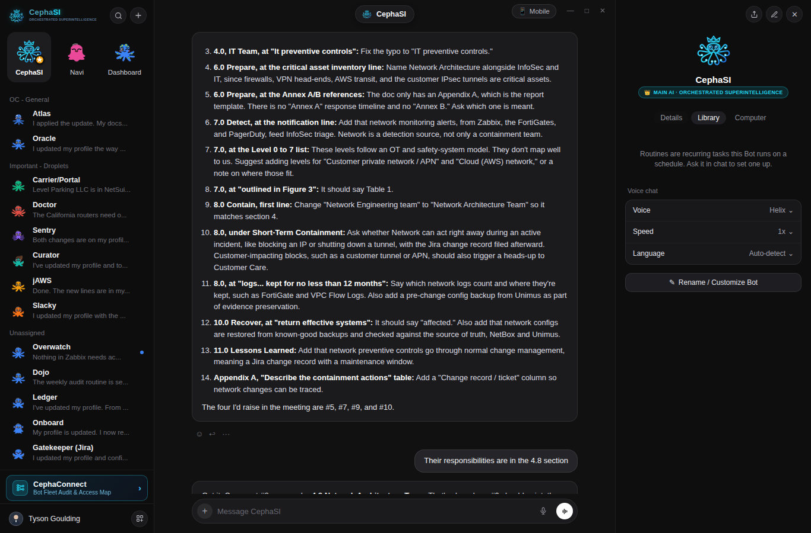
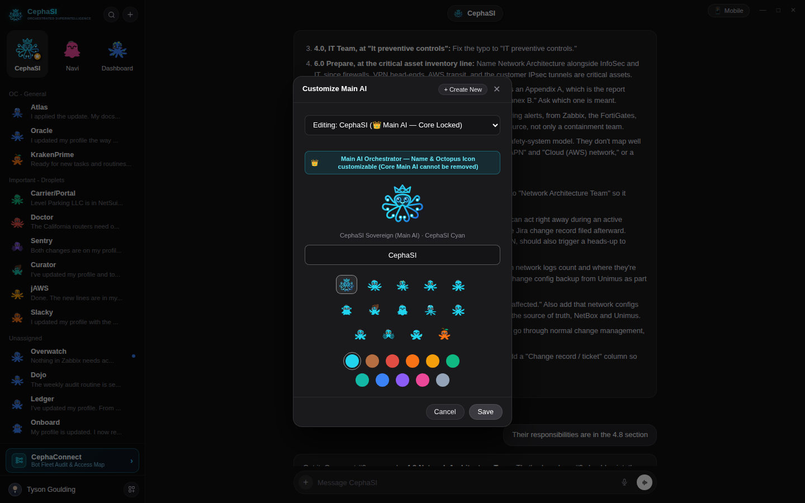
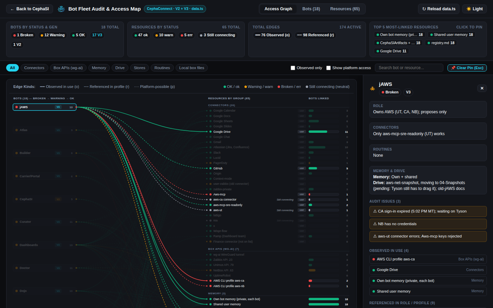
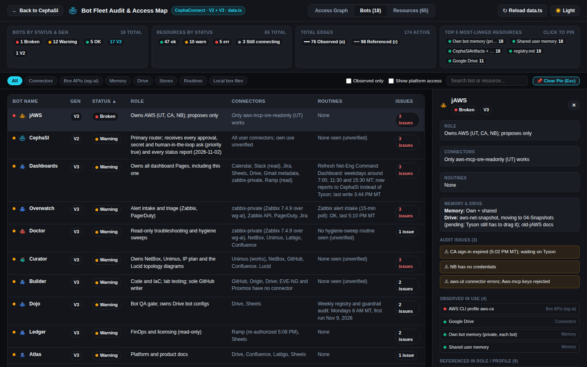
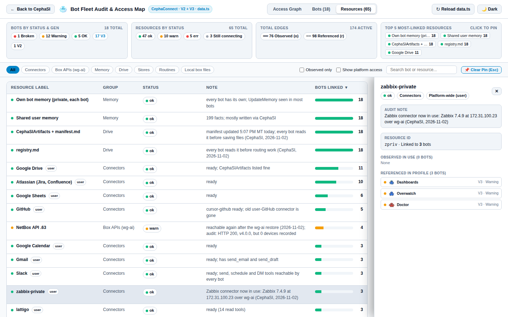
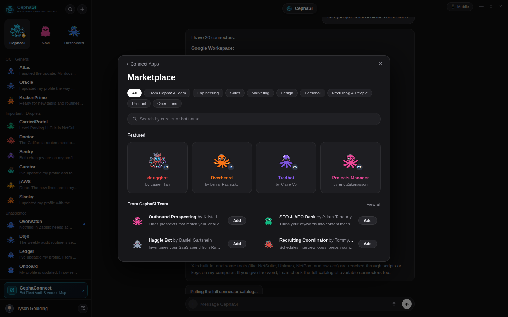
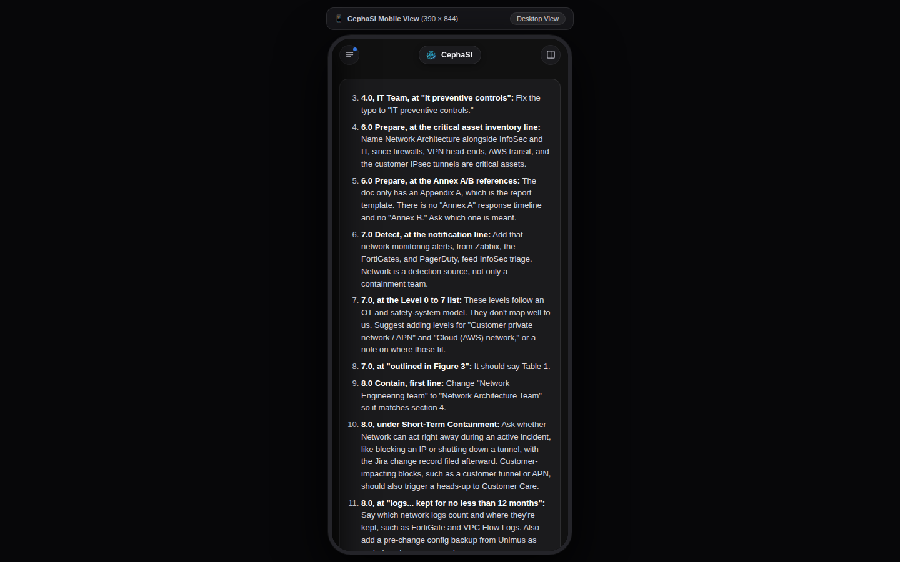

<div align="center">

# 🐙 CephaSI — Orchestrated Superintelligence

**Multi-Bot AI Workspace · Kawaii Cephalopod Fleet · `CephaConnect` Bipartite Access Map (V2 + V3)**

[](https://tysongoulding.github.io/CephaSI/)
[](https://tysongoulding.github.io/CephaSI/?view=cephaconnect)
[](https://tysongoulding.github.io/CephaSI/?mobile=1)

</div>

---

## 🚀 Live Interactive Showcase (GitHub Pages)

| View | Live Link | Description |
| :--- | :--- | :--- |
| **👑 CephaSI Main Workspace** | **[tysongoulding.github.io/CephaSI](https://tysongoulding.github.io/CephaSI/)** | Multi-bot chat interface, Crowned Sovereign Main AI (`CephaSI`), Right Inspector, Voice HUD, Settings & Bot Marketplace |
| **🕸️ CephaConnect Audit & Access Map** | **[tysongoulding.github.io/CephaSI/?view=cephaconnect](https://tysongoulding.github.io/CephaSI/?view=cephaconnect)** | Interactive SVG Bipartite Access Graph, sortable `Bots (18)` & `Resources (65)` tables, slide-over detail drawer, Dark/Light theme |
| **📱 Mobile View & Phone Frame** | **[tysongoulding.github.io/CephaSI/?mobile=1](https://tysongoulding.github.io/CephaSI/?mobile=1)** | Touch-friendly slide-over sidebar & inspector drawers for phones or desktop 390×844 preview |

---

## ✨ Visual Tour

### 1. 👑 Flagship Main AI (`CephaSI`) & Bot-to-Bot Inbox Architecture
`CephaSI` is permanently locked as the **Main AI · Orchestrated Superintelligence** router. Its name, octopus species icon, and color swatch can be customized at any time, while its flagship `Main AI` status cannot be removed or deleted.



---

### 2. 🐙 13 Expressive Kawaii Octopus Species & 11 Color Swatches
Choose from **Crowned CephaSI Sovereign** plus **12 real-world octopus species** (`Giant Pacific`, `Blue-Ringed`, `Mimic`, `Common`, `Dumbo`, `Coconut`, `Flapjack`, `Glass`, `Seven-Arm`, `Reef`, `Blanket`, and `Argonaut`), each illustrated with cute, happy kawaii eyes, rosy cheeks, and warm smiles:



---

### 3. 🕸️ `CephaConnect` — Bot Fleet Audit & Access Map (V2 + V3)
Accessible via the **`CephaConnect`** button directly above `Tyson Goulding` in the bottom-left sidebar (or via [`?view=cephaconnect`](https://tysongoulding.github.io/CephaSI/?view=cephaconnect)).
- **Bipartite SVG Access Graph**: Left column lists all 18 bots sorted `Broken` → `Warning` → `OK`; right column groups 65 resources across `Connectors`, `Box APIs (wg-ai)`, `Memory`, `Drive`, `Stores`, `Routines`, and `Local box files` with horizontal degree bars (`Bots linked`).
- **Edge Semantics**: Solid bezier curves for **Observed (`o`)**, dashed for **Referenced (`r`)**, and dotted for **Platform-wide (`p`)**.
- **Hover & Click-to-Pin Focus**: Hovering or clicking any bot or resource highlights its connected subgraph and opens the slide-over inspection panel.



#### Sortable Bots & Resources Audit Tables + Light/Dark Theme




---

### 4. 🧩 Connect Apps & Bot Templates Marketplace Modal
Browse workspace connectors (`Slack`, `HubSpot`, `Gmail`, `Google Calendar`, `GitHub`, `Jira`, `Notion`, `Linear`) and one-click Bot Templates (`Email Assistant`, `Calendar Assistant`, `Customer Support`, `Code Reviewer`, `Data Analyst`, `Research Agent`, `Incident Responder`, `Sales Ops`) inside an integrated modal:



---

### 5. 📱 Responsive Mobile Layout & Phone Frame Preview
Full responsive mobile layout (`<= 860px` or `?mobile=1`) with slide-over navigation drawers and a built-in `390×844` desktop phone preview toggle:



---

## 🗂️ Editing Fleet Data (`data.ts`)

All `CephaConnect` bot, resource, and link definitions live in [`data.ts`](./data.ts) (and [`src/data.ts`](./src/data.ts) for Vite builds):

- **Data Model**:
  - `Bot`: `{ id, name, gen: "V2"|"V3", status: "OK"|"Warning"|"Broken", role, conn, routines, memory, drive, issues: string[], links: string }`
  - `Resource`: `{ id, label, group, status: "ok"|"warn"|"err"|"neutral", note, user?: boolean }`
  - `links`: Space-separated `"resourceId:kind"` tokens (`o` = observed in use, `r` = referenced in profile, `p` = platform-possible via `user: true`).
- **Live Sync**: Both the local server (`server.mjs`) and the static GitHub Pages deployment fetch [`./data.ts`](./data.ts) dynamically—edit `data.ts` and click **`↻ Sync data.ts`** (or refresh the page) to see changes immediately.

---

## 🛠️ Running Locally

```bash
# Option 1: Zero-dependency Node server (serves index.html + live /api/data.json on port 3899)
npm start

# Option 2: Vite React + TypeScript dev server
npm install
npm run dev

# Run automated 27-view Playwright E2E verification suite
npm test
```
